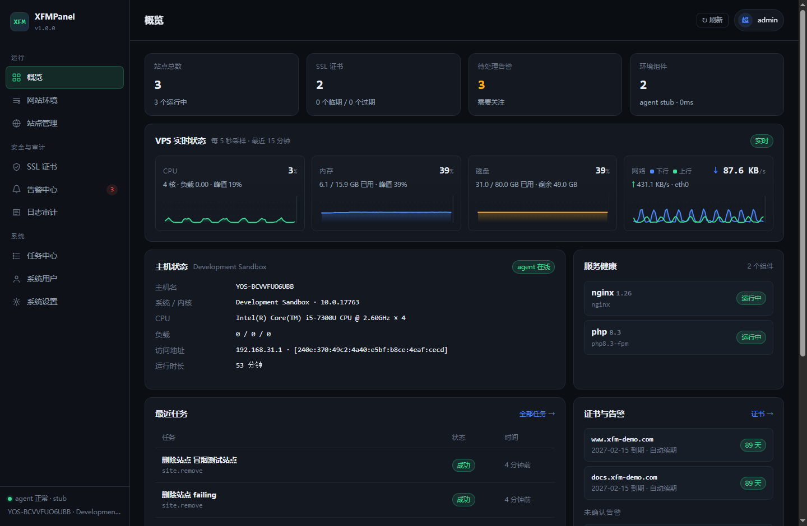
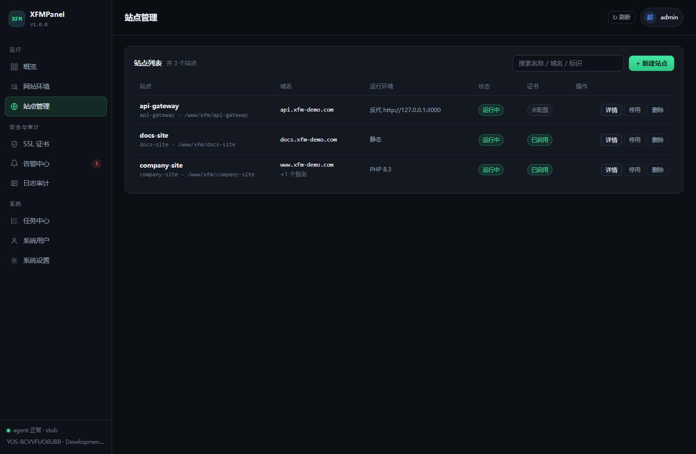
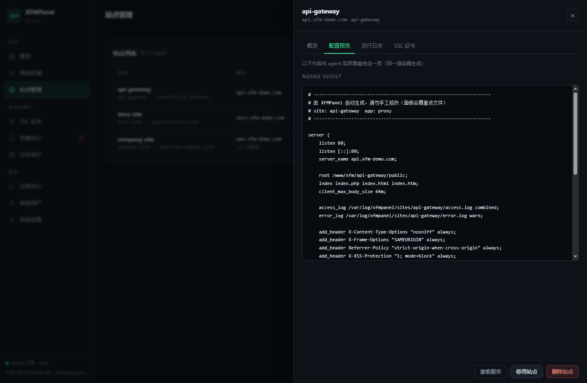

# XFMPanel

面向 VPS 的轻量主机管理面板：在 Web 界面里完成 **网站环境一键安装**、**站点全生命周期管理**、**SSL 证书自动签发与续期**，并保留完整的**操作审计**与**运行日志**。

> 设计目标不是"又一个宝塔"，而是给出一个**权限边界清晰、可审计、可维护**的最小可用实现：
> 面板进程不持有 root，所有特权操作经由签名校验的本地 agent 执行。



## 目录

- [功能](#功能)
- [安全模型](#安全模型)
- [技术选型](#技术选型)
- [快速开始](#快速开始)
- [项目结构](#项目结构)
- [核心模块](#核心模块)
- [接口一览](#接口一览)
- [测试](#测试)
- [已知限制](#已知限制)
- [文档](#文档)

## 功能

| 能力 | 说明 |
| --- | --- |
| 网站环境一键安装 | Nginx / PHP（多版本，独立 FPM pool）/ MariaDB / Redis / Node.js，基于 apt，幂等可重入，安装过程实时输出 |
| 环境参数与状态 | 版本选择与默认版本、服务启停/重启/重载、按内存自动计算 InnoDB buffer pool、Redis 随机密码、PHP 安全基线 |
| 站点管理 | 创建 / 修改 / 启停 / 重载 / 删除；PHP、静态、反向代理三种类型；伪静态预设；每站点独立系统用户与 FPM pool |
| VPS 状态监控 | 首页实时曲线：CPU、内存、磁盘、网络上下行；5 秒采样、15 分钟滑动窗口，数据来自 agent 的 `/proc` 采集 |
| 运行日志 | 面板结构化日志、站点 access/error/php-error 日志（按行数尾部读取）、任务实时日志（SSE） |
| SSL 证书 | Let's Encrypt 自动申请（HTTP-01 webroot，不停服务）、自动续期、到期巡检与告警、手动上传商业证书、吊销 |
| 异常提示 | 证书失败/临期/过期、站点配置失败、agent 离线、任务失败统一进入告警中心，按 dedupe key 去重，可确认 |
| 安全与审计 | 角色权限（owner/admin/operator/viewer）、CSRF 双提交、登录节流与锁定、全量写操作审计、CSP/HSTS |

## 安全模型

三层边界，任何一层被攻破都不会直接等于 root：

```
浏览器 ──HTTPS──> nginx ──> 面板进程（用户 xfmpanel，无 root）
                                 │  unix socket + HMAC-SHA256 签名
                                 ▼
                          agent 进程（root，op 白名单）
                                 │  execFile，永不经过 shell
                                 ▼
                        systemd / nginx / php-fpm / certbot / apt
```

| 措施 | 实现位置 |
| --- | --- |
| 面板与特权分离 | `panel`（xfmpanel 用户）↔ `agent`（root）仅通过 `/run/xfmpanel/agent.sock` 通信，socket 权限 `0660 root:xfmpanel` |
| 请求签名与防重放 | 每个请求 HMAC-SHA256 签名，±30s 时间窗 + nonce 去重（`agent/src/lib/security.js`） |
| 操作白名单 | agent 只认识注册表中的 op（`agent/src/ops/index.js`），每 op 独立参数校验 |
| 命令注入防护 | 全部使用 `spawn(cmd, argv)`，不拼接 shell 字符串（`agent/src/lib/exec.js`） |
| 路径越界防护 | 站点目录必须严格等于 `/www/xfm/<slug>`，写入/删除前做前缀 + realpath 复核（`agent/src/lib/fs-safe.js`） |
| 配置原子性与回滚 | 渲染 → 原子写 → `nginx -t` → 失败自动回滚上一版 vhost → 才 reload |
| 站点隔离 | 独立 Linux 用户（nologin）、独立 FPM pool、`open_basedir` 锁定、禁用 `exec/shell_exec/system` 等函数 |
| Web 安全 | 会话令牌仅存哈希、CSRF 双提交 + Origin 校验、登录失败节流与锁定、CSP、`X-Frame-Options`、HSTS |

## 技术选型

| 选型 | 理由 |
| --- | --- |
| Node.js 22，**零第三方依赖** | VPS 上无需 `node_modules`、无需原生模块编译；供应链攻击面最小；`npm install` 都不需要 |
| SQLite（`node:sqlite`，WAL） | 面板并发在"几十 QPS"量级，单文件数据库免运维、备份即拷贝；WAL 下读写不互斥 |
| 原生 HTML/CSS/JS 前端 | 无构建步骤，改完刷新即生效，便于二次开发和排障 |
| 任务队列落库 | 安装环境/签发证书动辄数分钟，必须异步化；进程重启后状态可恢复（运行中的任务标记失败并提示重试） |
| systemd + nginx | 与 VPS 运维习惯一致，无 Docker 依赖，资源占用低 |

## 快速开始

### 本地开发（Windows / macOS / Linux 均可）

```bash
git clone https://github.com/xfm0797/xfmpanel.git
cd xfmpanel
npm run dev          # 等价于 XFMP_ENV=dev node panel/src/server.js
```

- 首次启动会在 `data/initial-admin.txt` 生成管理员密码；面板地址 `http://127.0.0.1:8787`
- 开发模式自动使用 **stub agent**：不触碰真实系统，安装/建站/签发都有模拟流程与进度，可用于联调前端
- 想让任务失败以验证异常提示：域名里带 `fail`（如 `fail-test.example.com`）

产物：

```
data/xfmpanel.db           SQLite 数据库
data/logs/panel.log        面板日志（JSON Lines）
data/certs/                模拟证书文件
```

### VPS 生产部署（Debian 12 / Ubuntu 22.04+）

SSH 登录 root 后，一条命令就能装完 —— **不需要先克隆仓库**，脚本会自己拉源码：

```bash
wget -qO install.sh https://raw.githubusercontent.com/xfm0797/xfmpanel/main/deploy/install.sh
sudo bash install.sh --proxy-domain panel.example.com
```

也可以管道执行（脚本参数要写在 `-s --` 之后）：

```bash
curl -fsSL https://raw.githubusercontent.com/xfm0797/xfmpanel/main/deploy/install.sh \
  | sudo bash -s -- --proxy-domain panel.example.com
```

国内网络如果 `raw.githubusercontent.com` 打不开（很常见），换同一个文件的 CDN 地址：

```bash
wget -qO install.sh https://cdn.jsdelivr.net/gh/xfm0797/xfmpanel@main/deploy/install.sh
# 或锁定版本
wget -qO install.sh https://cdn.jsdelivr.net/gh/xfm0797/xfmpanel@v1.0.0/deploy/install.sh
```

没有域名、想先用 IP 直连：

```bash
sudo bash install.sh
```

源码来源可以换（仓库私有、要锁版本、或者内网无外网时）：

| 场景 | 命令 |
| --- | --- |
| 公开仓库（默认 `xfm0797/xfmpanel@main`） | `sudo bash install.sh` |
| 锁定版本 | `sudo bash install.sh --from xfm0797/xfmpanel@v1.0.2` |
| 私有仓库（只读 token） | `sudo bash install.sh --from https://<token>@github.com/xfm0797/xfmpanel.git` |
| 内网 / 无外网 | `scp xfmpanel.tar.gz root@vps:/root/` 后 `sudo bash install.sh --from /root/xfmpanel.tar.gz` |
| 已克隆仓库 | `sudo ./deploy/install.sh`（自动识别本地源码，不再下载） |

> URL 里的 `main` 是分支名，仓库默认分支若是 `master` 请相应替换。`raw.githubusercontent.com`、`codeload.github.com` 在部分网络环境（尤其国内）不可达时，用上面的 jsDelivr 地址即可，内容是同一份文件。
> 拉取源码默认 180s 超时，可 `XFMP_FETCH_TIMEOUT=300 sudo bash install.sh` 放宽；`--keep-src` 保留临时源码目录便于排查。

脚本会：**自动探测本机公网 IPv4 / IPv6** → 安装 Node 22 → 创建 `xfmpanel` 系统用户与目录 → 生成 agent 密钥与 `panel.env` → 安装两个 systemd 单元 → 启动并健康检查 → 可选生成 nginx 反代配置。

安装结束会直接把可用登录地址打印出来，无需自己去 `ip addr` 里找：

```
 登录地址：
   IPv4   : http://203.0.113.10:8787
   IPv6   : http://[2001:db8::1]:8787   (需本机与客户端都启用 IPv6)
   本机   : http://127.0.0.1:8787
```

- 未指定 `--proxy-domain` 时自动监听 `0.0.0.0`，保证探测到的地址能直接打开；指定后则只监听 `127.0.0.1`，由 nginx 终止 TLS。
- 探测顺序：`--public-ip` > 公网回显服务（ipify / icanhazip / ident.me）> 默认路由出口地址（NAT 型 VPS）。
- 可用 `--prefer-ipv6` 优先使用 IPv6、`--no-detect` 跳过探测、`--bind` 手工指定监听地址。

详细步骤、TLS、防火墙、升级与排障见 [docs/DEPLOYMENT.md](docs/DEPLOYMENT.md)。

## 项目结构

```
xfmpanel/
├── package.json                 # 零依赖；脚本入口
├── shared/                      # 面板与 agent 共用（同源，保证行为一致）
│   ├── protocol.js              # op 白名单、任务类型、角色、错误码
│   ├── paths.js                 # 目录约定（站点/日志/证书/配置路径）
│   ├── validate.js              # 域名、slug、路径等校验
│   └── render/
│       ├── nginx.js             # vhost 渲染（纯函数，可单测）
│       └── php-pool.js          # FPM pool 渲染 + 目录权限计划
├── panel/                       # 面板进程（非特权）
│   ├── src/
│   │   ├── server.js            # 入口：HTTP + 任务 worker + 定时巡检
│   │   ├── config.js            # 环境变量 → 配置
│   │   ├── db/                  # SQLite 连接、迁移、种子数据
│   │   ├── lib/                 # http 内核、错误、密码学、日志
│   │   ├── http/security.js     # 会话、限流、CSRF、权限守卫、审计
│   │   ├── services/            # 业务：sites/runtimes/certs/tasks/alerts/agent
│   │   └── routes/              # REST 路由（按资源拆分）
│   └── web/                     # 前端（无构建）
│       ├── index.html
│       └── assets/{app,api,ui}.js + views/*.js + styles.css
├── agent/                       # 特权进程（root）
│   └── src/
│       ├── agent.js             # unix socket 服务、验签、并发控制
│       ├── lib/                 # exec（argv 执行）、fs-safe、security、distro
│       └── ops/                 # system/service/runtime/site/cert 操作
├── deploy/
│   ├── install.sh / uninstall.sh
│   ├── systemd/                 # xfmpanel-panel.service / xfmpanel-agent.service
│   ├── nginx/xfmpanel.conf      # 反代示例（含 SSE 免缓冲）
│   ├── logrotate/xfmpanel
│   └── env.example
├── tests/run.mjs                # 端到端冒烟测试（35 项断言）
├── scripts/reset-admin.js       # 救急：重置密码 / 解锁账号
└── docs/                        # 架构、数据库、接口、部署文档
```

## 核心模块

| 模块 | 职责 | 关键设计 |
| --- | --- | --- |
| `panel/src/lib/http.js` | 路由、上下文、静态资源、错误信封、SSE | 约 300 行零依赖实现，避免框架升级与中间件漏洞面 |
| `panel/src/http/security.js` | 会话装载 → 限流 → CSRF → 审计 | 中间件顺序固定，权限以 `perm('site:write')` 声明在路由上 |
| `panel/src/services/sites.js` | 站点校验、状态机、配置规格组装 | 不直接执行系统命令，只产出受校验的 spec |
| `panel/src/services/tasks.js` | 队列、并发控制、事件流、取消 | 同目标互斥；重启后清扫 running 任务 |
| `panel/src/services/handlers.js` | 业务编排（建站 = 建用户 + 写配置 + 重载 + 证书） | 失败必须落 `last_error` 并产生告警 |
| `panel/src/services/certs.js` | 证书状态机、巡检、自动续期入队 | 每 6 小时巡检；临期 30 天自动续期；失败升级为 critical |
| `agent/src/ops/site.js` | 建用户/目录、写 vhost 与 pool、`nginx -t`、回滚 | 站点路径强约束，配置内容由 shared 渲染器生成 |
| `agent/src/ops/runtime.js` | apt 安装与基线配置 | 幂等、按内存调参、输出流式回传 |
| `agent/src/ops/cert.js` | certbot webroot 签发/续期/吊销/上传 | 上传时校验证书与私钥匹配、过期时间 |

请求生命周期（以"创建站点"为例）：

```
POST /api/v1/sites
  → 会话/限流/CSRF/权限
  → sites.createSite()：校验域名唯一、PHP 已安装、目录约定
  → 写 sites + site_domains 行（状态 pending）
  → createTask('site.create') 立即返回 201 { site, task }
  → worker: agent site.provision → 建用户 → 建目录 → 写配置 → nginx -t → reload
  → 若勾选 ACME：dns.check → cert.issue → site.apply（带 ssl）→ 状态 active
  → 任何失败：last_error + alerts 记录 + 任务事件流可见
```

## 接口一览

统一前缀 `/api/v1`，成功 `{ ok: true, data }`，失败 `{ ok: false, error: { code, message } }`。

| 分类 | 端点 |
| --- | --- |
| 认证 | `POST /auth/login`、`POST /auth/logout`、`GET /auth/me`、`POST /auth/password` |
| 站点 | `GET/POST /sites`、`GET/PATCH/DELETE /sites/:id`、`POST /sites/:id/state`、`POST /sites/:id/reload`、`GET /sites/:id/config`、`GET /sites/:id/logs` |
| 环境 | `GET /runtimes`、`POST /runtimes/install`、`POST /runtimes/:id/default`、`POST /runtimes/:id/service`、`DELETE /runtimes/:id` |
| 证书 | `GET /certificates`、`POST /certificates/issue`、`POST /certificates/:id/renew`、`.../revoke`、`POST /certificates/upload`、`POST /certificates/scan` |
| 任务 | `GET /tasks`、`GET /tasks/:id`、`GET /tasks/:id/events`（SSE）、`POST /tasks/:id/cancel` |
| 日志 | `GET /logs/panel`、`GET /logs/audit` |
| 系统 | `GET /system/health`、`GET /system/overview`、`GET /system/paths` |
| 用户/设置/告警 | `/users`、`/settings`、`/alerts` |

完整参数、示例与错误码见 [docs/API.md](docs/API.md)。

## 测试

```bash
npm start &            # 或 npm run dev
npm test               # 端到端：登录 → 装环境 → 建站 → 证书 → 停用/启用 → 删除
```

测试覆盖 35 项断言，包含：未登录 401、CSRF 拒绝、安装任务、站点状态机、配置渲染、证书续期、失败任务与 `lastError`、审计与日志、删除清理。

```bash
npm run reset-admin -- --list                    # 查看账号
npm run reset-admin -- --password 'NewPass1234'  # 重置超管密码并踢出会话
```

## 已知限制

- 自动安装目前支持 **Debian 系**（Debian 12 / Ubuntu 22.04+）；RHEL 系会明确报错而非静默失败。
- `node:sqlite` 在 Node 22 仍标记为 experimental（API 稳定，生产需接受该提示；单元文件已加 `--disable-warning`）。
- 单租户设计：一个面板管理一台 VPS，不做多用户隔离的"客户主机"场景。
- 反向代理站点只支持本机 upstream，避免面板被当作开放代理滥用。

## 文档

| 文档 | 内容 |
| --- | --- |
| [docs/ARCHITECTURE.md](docs/ARCHITECTURE.md) | 模块划分、权限边界、任务引擎、错误处理、可维护性 |
| [docs/DATABASE.md](docs/DATABASE.md) | 表结构、索引、状态机、设计取舍 |
| [docs/API.md](docs/API.md) | 全部接口、参数、示例、错误码 |
| [docs/DEPLOYMENT.md](docs/DEPLOYMENT.md) | 安装、配置、TLS、防火墙、升级、备份、排障 |

## 截图

| 站点列表 | 配置预览（与落盘同源） |
| --- | --- |
|  |  |

## License

MIT
